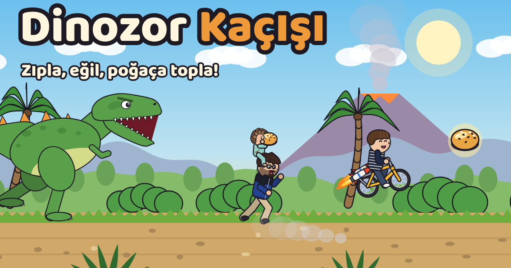

# Dinozor Kaçışı 🦖

Dayı, Arif ve Asım'ın dinozorlardan kaçtığı, tarayıcıda oynanan bir koşu oyunu. Kurulum yok; bağlantıyı açıp oynaman yeterli.

**▶ Oyna:** https://yusufbabali.github.io/dinozor-kacisi/

Üstteki **tam ekran** düğmesiyle oyun bütün ekranı kaplar; telefonu yan çevirirsen düğmeler oyunun iki yanına geçer. Telefonda **Paylaş → Ana Ekrana Ekle** dersen oyun uygulama gibi, tarayıcı çubukları olmadan açılır.

## Nasıl oynanır

| | Bilgisayar | Telefon |
|---|---|---|
| Zıpla | Boşluk veya ↑ (basılı tut, daha yükseğe) | Ekrana dokun veya **Zıpla** |
| Eğil | ↓ | **Eğil** düğmesi |
| Özel güç | X veya → | Ortadaki düğme |
| Mola | P veya Esc | Üstteki ⏸ düğmesi |
| Karakter seç | 1, 2, 3 | Karta dokun |

- İlk çarpmada tökezlersin, ikincisinde dinozor yakalar. Kalbin bir süre sonra yeniden dolar.
- Her 1000 puanda yeni bir dinozor gelir: T-Rex, Triseratops, Spinozor. Gökyüzü de gündüzden gün batımına, oradan geceye döner.
- Poğaça topla: her biri +20 puan.

## Karakterler

- **Dayı:** Fırlar, tökezleyince hemen toparlanır (3 hak).
- **Arifli Dayı:** Arif poğaçasını yer, dinozora sınırsız poğaça atar.
- **Asım:** Bisikletle kaçar, havadayken roketle bir kez daha zıplar (3 roket).

Rekorlar her karakter için ayrı tutulur ve yalnızca oynadığın cihazda saklanır.
